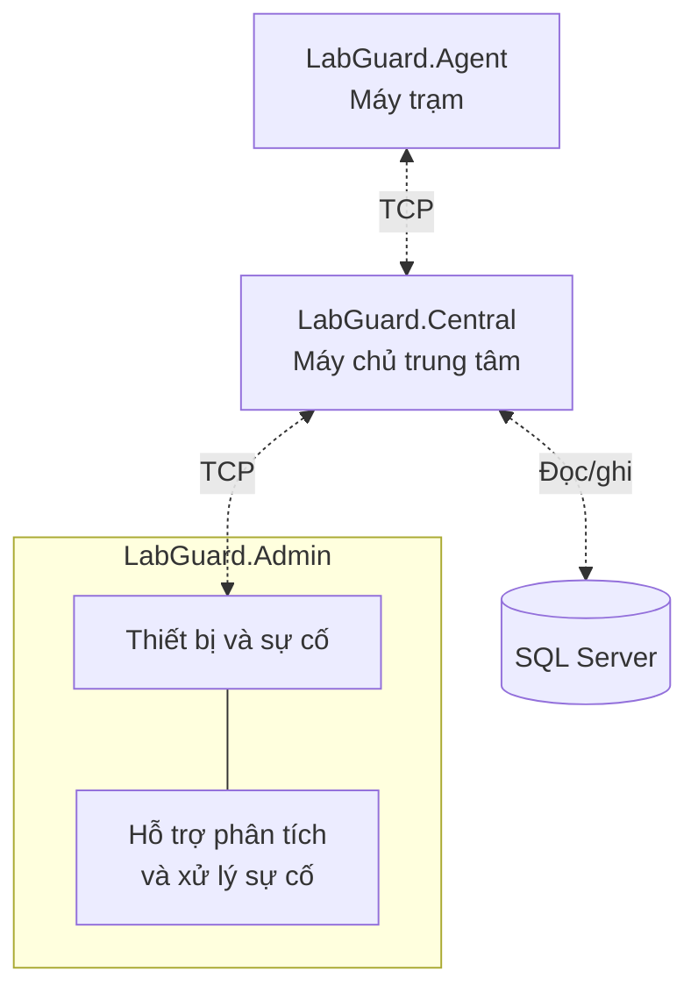

# LabGuard — Giám sát phòng máy tập trung

**Đồ án môn NT106 — Lập trình mạng căn bản · Nhóm 5**

**Trường Đại học Công nghệ Thông tin, ĐHQG-HCM (UIT)**

LabGuard hướng đến việc giúp người quản trị theo dõi tình trạng máy tính trong phòng thực hành từ một giao diện chung, thay vì kiểm tra từng máy riêng lẻ. Hệ thống dự kiến thu thập CPU, RAM, thời gian hoạt động và tình trạng kết nối; tập trung dữ liệu để phát hiện, theo dõi và hỗ trợ xử lý sự cố.

Đồ án thực hành mô hình Client–Server, lập trình TCP, đóng khung thông điệp JSON và phối hợp giữa ứng dụng mạng, cơ sở dữ liệu và giao diện Windows Forms. **Mã nguồn hiện được triển khai từng phần; luồng giám sát hoàn chỉnh từ Agent qua Central đến Admin chưa được nghiệm thu.**

## Kiến trúc và luồng truyền thông

Sơ đồ dưới đây mô tả **kiến trúc dự kiến**, không phải bằng chứng toàn hệ thống đã kết nối thành công. Các mũi tên nét đứt là luồng cần hoàn thiện và tích hợp; đây là sơ đồ giao tiếp phần mềm, không biểu diễn dây mạng vật lý.



Hiện đã có thử kết nối TCP và gửi HELLO từ Agent đến listener Central. Việc này **chưa xác nhận** phiên được xác thực, số liệu được lưu vào SQL hay Admin nhận được dữ liệu. Thu số liệu tại máy và bố cục Admin cũng có thể chạy riêng, chưa tạo thành một luồng giám sát tích hợp.

### Các thành phần và chức năng dự kiến

| Thành phần | Vai trò trong hệ thống khi hoàn thiện |
|---|---|
| `LabGuard.Agent` | Thu thập dữ liệu tài nguyên máy trạm và gửi đến Central; quản lý kết nối và dữ liệu cần gửi lại theo thiết kế. |
| `LabGuard.Central` | Tiếp nhận thông điệp, xác thực, xử lý dữ liệu, đánh giá điều kiện cảnh báo và cung cấp dữ liệu cho Admin. |
| SQL Server | Lưu các batch đã xử lý, mẫu số liệu và sự cố trong ba bảng `ProcessedBatches`, `MetricSamples`, `Incidents`. Central là thành phần truy cập cơ sở dữ liệu. |
| `LabGuard.Admin` | Hiển thị thiết bị, cảnh báo và quy trình tiếp nhận, theo dõi, xử lý sự cố bằng Windows Forms. |
| Chức năng hỗ trợ phân tích và xử lý sự cố | Tích hợp trong Admin, sử dụng dữ liệu có thẩm quyền qua Central để hiển thị bằng chứng, nhận định và đề xuất bước kiểm tra. Không tự khẳng định nguyên nhân hoặc tự sửa máy. |

Công cụ kiểm thử truyền thông TCP phục vụ kiểm tra kết nối, gửi, nhận và chuyển tiếp dữ liệu; không thay thế chức năng hỗ trợ xử lý sự cố trong Admin. Gateway/Collector chỉ là hướng mở rộng tùy chọn sau khi phần cốt lõi ổn định, không thuộc kiến trúc cốt lõi trên.

## Trạng thái triển khai thực tế

| Mức độ | Phạm vi hiện tại |
|---|---|
| **Đã triển khai và kiểm chứng từng phần** | Cấu trúc thông điệp và `FrameCodec`; các thành phần transport/collector của Agent, chương trình Console, cấu hình JSON, `DeviceId` riêng mỗi bản cài đặt, thu CPU/RAM/thời gian hoạt động trên Windows và thử TCP/HELLO; listener Central nhiều kết nối; TcpEcho và công cụ giả lập giao thức độc lập `mock_harness`. |
| **Đang triển khai** | Tích hợp SQL: đã có DDL ba bảng, chưa nghiệm thu phần lưu dữ liệu từ C#. Admin: đã có bố cục giao diện 0.1, chưa nghiệm thu kết nối dữ liệu và quy trình quản trị. |
| **Chưa triển khai hoặc chưa nghiệm thu** | Phiên kết nối/xác thực, TLS, kiểm tra mất liên lạc, kết nối lại (A-005), `ReplayBuffer` (A-006), lưu SQL và ACK sau khi ghi thành công, quy tắc cảnh báo, quy trình xử lý sự cố, chức năng hỗ trợ phân tích và xử lý sự cố, `ServiceMonitor` và Windows Service. |

**Chế độ giám sát Agent vẫn bị chặn** đến khi phần bảo mật, phiên kết nối và xác thực hoàn thiện. Việc có chương trình khởi chạy không có nghĩa A-005/A-006 đã hoàn thành. Simulator hiện chỉ là phần khung chờ triển khai.

Kết quả kiểm chứng được ghi nhận từ PR #11 và lượt đồng bộ tài liệu: **195 bài kiểm thử đạt trên Windows cục bộ** (Protocol 107, Agent 64, Central 9, MockHarness 15). Đây không phải kết quả GitHub CI và không chứng minh luồng SQL/ACK, triển khai LAN hoặc Windows Service đã hoạt động. Xem [trạng thái và lịch sử nghiệm thu](PROJECT_STATE.md) cùng [bằng chứng, cách chạy lại](docs/agent_deployment/VALIDATION_EVIDENCE.md).

## Cài đặt, biên dịch và chạy thử

Cần **Windows, SDK .NET 9 và PowerShell 7**. Clone repository rồi mở terminal tại thư mục chứa `LabGuard.sln`. Lần khôi phục thư viện đầu tiên có thể cần Internet. Hướng dẫn cấu hình và giới hạn triển khai chi tiết ở [tài liệu triển khai Agent](docs/agent_deployment/README.md).

### 1. Biên dịch và chạy bộ kiểm thử

```powershell
dotnet build LabGuard.sln
dotnet test LabGuard.sln
```

### 2. Tạo cấu hình Agent và thu số liệu cục bộ

```powershell
dotnet run --project src/LabGuard.Agent -- --init-config ./scratch/agentsettings.json --central-host 127.0.0.1 --central-port 5000
dotnet run --project src/LabGuard.Agent -- --config ./scratch/agentsettings.json --validate-config
dotnet run --project src/LabGuard.Agent -- --config ./scratch/agentsettings.json --collect-once
```

Lệnh đầu chỉ dùng khi tạo cấu hình mới, từ chối ghi đè file đã tồn tại. Mỗi máy cần cấu hình và `DeviceId` riêng; không sao chép cấu hình đã tạo sang các máy khác hoặc đưa cấu hình chứa định danh/bí mật lên Git. `--collect-once` chỉ đọc số liệu tại máy, không gửi mạng hoặc đánh giá sự cố.

### 3. Thử kết nối Agent → Central trên cùng máy

Terminal thứ nhất, chạy Central (hiện lắng nghe TCP cổng 5000):

```powershell
dotnet run --project src/LabGuard.Central
```

Terminal thứ hai, dùng cấu hình vừa tạo để thử kết nối:

```powershell
dotnet run --project src/LabGuard.Agent -- --config ./scratch/agentsettings.json --probe
```

`--probe` mở TCP thường trong môi trường phát triển và đưa HELLO vào hàng đợi gửi; đối chiếu log Central để biết thông điệp có được nhận. Chế độ này không gửi số liệu/heartbeat/token, không hoàn tất xác thực, lưu SQL hoặc nhận ACK ứng dụng. Exit 0 chỉ cho biết lệnh kết thúc; chưa có bộ đọc phản hồi để luôn phát hiện phía bên kia đóng kết nối im lặng.

`127.0.0.1` chỉ dùng trên cùng máy. Khi thử LAN, phải dùng địa chỉ Central và môi trường được phép. Chạy Agent không chọn chế độ thử sẽ dừng với exit 5 vì chế độ giám sát chưa sẵn sàng.

### 4. Mở giao diện Admin và công cụ TcpEcho

Mở bố cục Windows Forms hiện có; dữ liệu hiển thị chưa phải dữ liệu giám sát lấy từ Central:

```powershell
dotnet run --project src/LabGuard.Admin
```

Chạy TcpEcho trong terminal riêng (mặc định cổng 5050). Công cụ gửi trả lại các byte nhận được từ TCP client; đây không phải Central và không xử lý nghiệp vụ LabGuard:

```powershell
dotnet run --project tools/TcpEcho
```

Dừng các chương trình Console đang chạy bằng `Ctrl+C`; đóng cửa sổ Admin khi kết thúc. Các bước trên không cài Windows Service hoặc cấu hình SQL Server.

## Phân công Nhóm 5

Theo [quyết định trực tiếp của người điều phối ngày 17/10/2026](docs/internal/TEAM_ASSIGNMENTS.md):

| Thành viên | MSSV | Trách nhiệm chính thức |
|---|---|---|
| A — Võ Trọng Phúc | 25521452 | Agent và giao thức (Protocol). |
| B — Nguyễn Bá Quang | 25521524 | Central Server, SQL Server và xử lý sự cố tại máy chủ. |
| C — Lý Tuyết Vy | 25522107 | Admin Windows Forms và quy trình quản trị. |
| D — Đỗ Minh Ngọc | 25521203 | Công cụ kiểm thử truyền thông TCP và chức năng hỗ trợ phân tích, xử lý sự cố tích hợp trong LabGuard. |

Ngọc phối hợp với Quang để nhận dữ liệu qua Central và với Vy để tích hợp chức năng hỗ trợ xử lý sự cố vào Admin. Đây là trách nhiệm phát triển chính thức, chưa phải chức năng đã hoàn thành. Chi tiết phạm vi và phụ thuộc ở [ma trận trách nhiệm](docs/internal/OWNERSHIP_MATRIX.md) và [bản đồ phụ thuộc](docs/internal/DEPENDENCY_MAP.md).

## 5 sổ tay hướng dẫn LabGuard

Các sổ tay giải thích thiết kế, kiến thức và kế hoạch triển khai; ví dụ về chức năng dự kiến không phải bằng chứng chức năng đã chạy.

- **[Sổ tay tổng quan](docs/pdf/LabGuard_Tong_Quan_A-Z.pdf)** — Mục tiêu, kiến trúc, luồng dữ liệu, lộ trình và cách phối hợp toàn nhóm.
- **[Sổ tay Võ Trọng Phúc](docs/pdf/LabGuard_Huong_Dan_Thanh_Vien_A.pdf)** — Giao thức, đóng khung TCP, thu số liệu và kế hoạch hoàn thiện Agent.
- **[Sổ tay Nguyễn Bá Quang](docs/pdf/LabGuard_Huong_Dan_Thanh_Vien_B.pdf)** — Central Server, SQL Server, xử lý dữ liệu và sự cố.
- **[Sổ tay Lý Tuyết Vy](docs/pdf/LabGuard_Huong_Dan_Thanh_Vien_C.pdf)** — Giao diện Windows Forms, kết nối Central và quy trình quản trị sự cố.
- **[Sổ tay Đỗ Minh Ngọc](docs/pdf/LabGuard_Huong_Dan_Thanh_Vien_D.pdf)** — Kiểm thử truyền thông TCP và hỗ trợ phân tích, xử lý sự cố trong Admin; Gateway/Collector là tài liệu tham khảo tùy chọn.

### Tài liệu liên quan

- [START_HERE.md](START_HERE.md): bắt đầu theo phần việc; [FILE_MAP.md](FILE_MAP.md): vị trí và vai trò các file.
- [TODO.md](TODO.md), [WBS](docs/internal/WBS_TASKS.csv) và [bảng theo dõi Excel](LabGuard_Task_Tracker.xlsx): nhiệm vụ, phụ thuộc và tiến độ.
- [Đặc tả giao thức](docs/spec/PROTOCOL_SPEC.md): hợp đồng thông điệp hiện hành; [schema SQL](database/schema.sql): cấu trúc cơ sở dữ liệu hiện có.
- [Nguồn và cách biên dịch sổ tay PDF](docs/pdf/README.md).
