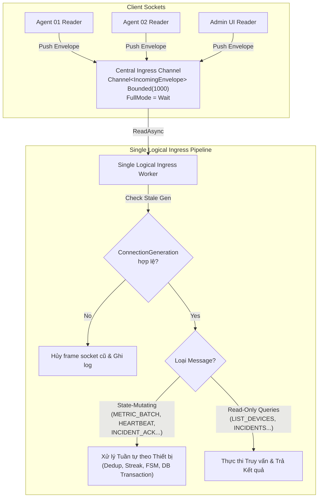

# LABGUARD — CHUYÊN ĐỀ CONCURRENCY & RELIABILITY
**Mã tài liệu:** `research/03_CONCURRENCY_RELIABILITY.md`  
**Chuyên đề:** Kiến trúc Đa luồng Bất đồng bộ (Async Concurrency), Điều tiết Áp lực ngược (Backpressure), Tuần tự hóa theo Thiết bị (Per-Device Ordering), Tự phục hồi Kết nối (Auto-Reconnect) & Hàng đợi Chưa xác nhận (Unacknowledged Telemetry Queue)  
**Môn học:** NT106 — Lập trình mạng căn bản (Khoa MMT&TT, UIT)  
**Trạng thái:** CHECKPOINT 2 REV2 — FREEZE CANDIDATE (READY FOR FINAL INDEPENDENT AUDIT)  
**Đối tượng thụ hưởng:** Thành viên A (Agent/Simulator), Thành viên B (Central Server/DB), Thành viên C (Admin Client)  

---

## 1. TỔNG QUAN & MỤC TIÊU CHUYÊN ĐỀ

Trong hệ thống giám sát mạng phòng máy LabGuard, hàng chục máy trạm (Agent) đồng thời truyền dữ liệu về một máy chủ trung tâm (Central Server), trong khi các máy quản trị (Admin Dashboard) liên tục gửi lệnh và nhận sự kiện thời gian thực.
Nếu lập trình đa luồng theo lối mòn truyền thống (tạo mới một `Thread` hệ điều hành cho mỗi kết nối, dùng các lệnh đồng bộ như `Thread.Sleep`, `Stream.Read`, `Stream.Write`), hệ thống sẽ đối mặt với các vấn đề kỹ thuật:
- **Cạn kiệt tài nguyên (Thread Pool Starvation):** Hàng trăm thread bị khóa cứng (blocked) chờ I/O mạng khiến CPU lãng phí tài nguyên chuyển ngữ cảnh (Context Switching).
- **Tranh chấp đường truyền (Race Conditions & Frame Interleaving):** Hai luồng cùng gọi `NetworkStream.WriteAsync` trên một Socket khiến các byte của hai gói tin bị trộn lẫn vào nhau, phá vỡ cấu trúc Length-Prefix Framing.
- **Tràn bộ nhớ (Out-Of-Memory do thiếu Backpressure):** Khi máy chủ bị nghẽn mạng hoặc database ghi chậm, hàng chục nghìn gói tin đổ dồn về bộ nhớ đệm không giới hạn làm sập ứng dụng.
- **Bão kết nối lại (Reconnect Storm):** Khi Central Server khởi động lại, 50 máy trạm cùng lúc kết nối lại tại giây thứ 1 làm nghẽn hàng đợi kết nối (TCP backlog).
- **Xáo trộn thứ tự gói tin (Message Reordering):** Nếu cho phép nhiều worker xử lý song song các mẻ đo (`METRIC_BATCH`) từ cùng một máy trạm mà không có cơ chế tuần tự hóa, chuỗi mẫu CPU/RAM sẽ bị đảo lộn, làm sai lệch logic chuỗi liên tiếp (Streak) và máy trạng thái sự cố.

Chuyên đề này đóng vai trò là tài liệu đặc tả kỹ thuật của Checkpoint 2, giúp 3 sinh viên lập trình chính xác, tránh các lỗi kinh điển và bảo vệ giải pháp trước hội đồng vấn đáp.

---

## 2. BẢN CHẤT ASYNCHRONOUS PROGRAMMING TRONG .NET 9 CHO SINH VIÊN NĂM 2

### 2.1. Phân biệt rõ ràng: Thread vs ThreadPool vs Task & Async/Await
1. **Thread (Hạt nhân hệ điều hành - OS Thread):**
   - Là đơn vị thực thi cấp OS, tốn khoảng **1 MB stack memory** trên Windows x64 và tốn chi phí CPU khi chuyển ngữ cảnh giữa các nhân phần cứng.
   - Nếu có nhiều kết nối socket mà tạo mỗi kết nối một OS Thread riêng biệt, hệ thống sẽ tiêu tốn bộ nhớ chỉ để giữ luồng rỗng và CPU mất nhiều thời gian chuyển đổi ngữ cảnh.
2. **ThreadPool (.NET Thread Pool):**
   - Là một nhóm luồng công nhân (Worker Threads) được .NET CLR quản lý sẵn (mặc định tương ứng số core CPU). Các tác vụ nhỏ được xếp vào hàng đợi chung để các worker thread này xử lý luân phiên.
3. **Task & Async/Await (Cooperative Asynchronous Multitasking):**
   - `Task` đại diện cho một công việc sẽ hoàn thành trong tương lai.
   - Khi gọi `await stream.ReadAsync(...)`, luồng hiện tại không bị chặn cứng. Nó đăng ký một hàm gọi lại thông qua I/O Completion Port (IOCP) của Windows rồi quay về ThreadPool phục vụ kết nối khác.
   - Khi card mạng nhận đủ dữ liệu và ngắt phần cứng kích hoạt, Windows thông báo cho IOCP. .NET ThreadPool sẽ điều phối một worker thread rảnh để tiếp tục thực thi các dòng code ngay sau lệnh `await`.

> [!NOTE]
> **Quy tắc cho nhóm:** Tuyệt đối không dùng `Thread.Sleep()`, không dùng `.Result`, không dùng `.Wait()`. Toàn bộ thao tác I/O mạng, đĩa và database sử dụng `await ...Async()`.

---

## 3. MÔ HÌNH CONCURRENCY PHÍA AGENT (THÀNH VIÊN A)

### 3.1. Vấn đề thực tế
Agent chạy như một dịch vụ nền (Background Service hoặc Console App chạy ẩn). Agent có 3 nhiệm vụ song song:
1. Gửi `HEARTBEAT` định kỳ mỗi 5.0 giây.
2. Thu thập CPU/RAM và gửi `METRIC_BATCH` mỗi 5.0 giây.
3. Nhận phản hồi và lệnh điều khiển từ Central Server (`HELLO_ACK`, `AUTH_RESULT`, `HEARTBEAT_ACK`, `BATCH_ACK`, `PING`).

Nếu timer đo CPU và timer Heartbeat cùng lúc gọi `stream.WriteAsync(...)`:
- Dòng byte của gói `HEARTBEAT` và `METRIC_BATCH` sẽ bị xen kẽ vào nhau (Frame Interleaving).
- Phía Server đọc được 4 byte length nhưng nội dung payload JSON bị trộn lẫn, gây ra lỗi vỡ khung `EndOfStreamException` hoặc `JsonException`.

### 3.2. Mô hình Single Writer Loop & Quản lý Hàng đợi Nhất quán
Để tránh tranh chấp ghi đồng thời mà không làm phức tạp hóa mã nguồn, Agent áp dụng mô hình **Single Writer Loop**:

```mermaid
graph TD
    subgraph Agent Connected State
        T1["Heartbeat Timer (5s)"] -->|Enqueue| Chan["Agent Outbox Channel<br/>Channel&lt;byte[]&gt; Bounded(256)<br/>FullMode = Wait"]
        T2["Metrics Sampler (5s)"] -->|Enqueue| Chan
        T3["Replay Buffer Drainer"] -->|Enqueue| Chan
        
        Chan -->|ReadAsync| Writer["Single Writer Background Task<br/>(Duy nhất ghi ra Socket)"]
        Writer -->|WriteFrameAsync| NetStream["NetworkStream / SslStream"]
        
        NetStream -->|ReadFrameAsync| Reader["Single Reader Background Task<br/>(Duy nhất đọc từ Socket)"]
        Reader -->|Sequential Dispatch| Dispatcher["Agent Dispatcher<br/>(Xử lý HELLO_ACK, AUTH_RESULT, PING)"]
    end
    
    NetStream <===>|TCP Socket (Length-Prefix 4B + JSON UTF-8)| Central["Central Server"]
```

### 3.3. Đặc tả Hàng đợi và Quyền sở hữu Telemetry (Telemetry Ownership & Queue Policy)
Để đảm bảo tính nhất quán và loại bỏ mâu thuẫn chính sách, hệ thống đóng băng nguyên tắc sở hữu dữ liệu đơn nhất:

**Nguyên tắc Quyền sở hữu Telemetry (Telemetry Ownership Rule):**
Một mẻ đo `METRIC_BATCH` luôn thuộc quyền sở hữu của Agent trong hàng đợi telemetry chưa xác nhận (`ReplayBuffer` / Unacknowledged Telemetry Queue) cho tới khi nhận được bản tin `BATCH_ACK` tương ứng từ Central Server.

Quy trình quản lý hàng đợi và vòng đời kết nối:
1. **Khởi tạo Mẻ đo:** Agent tạo `METRIC_BATCH` với bộ ba cố định: `DeviceId`, `BootId` (`Guid`), `BatchId` (`Guid` v4).
2. **Lưu trữ trước khi gửi:** Mẻ đo được nạp vào hàng đợi chưa xác nhận `ReplayBuffer` (dung lượng cố định 50 batches).
3. **Khi ĐANG KẾT NỐI (CONNECTED):**
   - Hàng đợi `AgentOutboxChannel`: `Channel.CreateBounded<byte[]>(new BoundedChannelOptions(256) { FullMode = BoundedChannelFullMode.Wait, SingleWriter = false, SingleReader = true })`.
   - Nếu đã xác thực (`AUTH_RESULT` thành công): Gửi mẻ đo chưa xác nhận cũ nhất ra `AgentOutboxChannel`.
4. **Giải phóng Quyền sở hữu:** Agent **chỉ xóa mẻ đo khỏi `ReplayBuffer` khi và chỉ khi nhận được bản tin `BATCH_ACK` có `BatchId` trùng khớp**.
5. **Khi MẤT KẾT NỐI hoặc TIMEOUT ACK (DISCONNECTED / TIMEOUT):**
   - Hủy bỏ và đóng outbox channel của phiên cũ.
   - **Tạm dừng tạo `HEARTBEAT`**: Timer Heartbeat dừng ghi vào outbox khi chưa có phiên hợp lệ. Tuyệt đối không đưa Heartbeat vào `ReplayBuffer`.
   - **Giữ nguyên mẻ đo trong `ReplayBuffer`**: Tuyệt đối không xóa mẻ đo khi chưa có ACK; giữ nguyên giá trị `BatchId` gốc.
   - Khi `ReplayBuffer` vượt quá sức chứa 50 batches: Áp dụng cơ chế **FIFO Drop-Oldest** (loại bỏ mẻ cũ nhất) và ghi log tường minh sự kiện `TELEMETRY_DROPPED`.
6. **Khi KẾT NỐI LẠI THÀNH CÔNG (RECONNECTED):**
   - Khởi tạo một `AgentOutboxChannel(256)` mới sạch hoàn toàn.
   - Bắt đầu quy trình bắt tay chuẩn: Gửi `HELLO_AGENT` $\rightarrow$ chờ `HELLO_ACK` $\rightarrow$ Gửi `AUTH_AGENT` $\rightarrow$ chờ `AUTH_RESULT`.
   - Sau khi nhận `AUTH_RESULT(success == true)`, khởi động lại timer gửi `HEARTBEAT` chu kỳ 5.0 giây.
   - Tiến trình xả hàng đợi kích hoạt: Lấy tuần tự từng mẻ đo chưa xác nhận trong `ReplayBuffer` gửi lên Server kèm cờ `"isReplay": true`, mỗi mẻ chờ nhận `BATCH_ACK` trước khi gửi mẻ tiếp theo.
7. **Phạm vi Bản tin trong ReplayBuffer:**
   - **Chỉ duy nhất `METRIC_BATCH`** được lưu trữ và quản lý quyền sở hữu trong `ReplayBuffer`.
   - Bản tin `SERVICE_STATUS` là telemetry trạng thái mới nhất (latest-state telemetry), không lưu trong `ReplayBuffer` và không thử lại tầng ứng dụng. Nếu bị mất trong lúc ngắt kết nối, chu kỳ probe kế tiếp sẽ gửi trạng thái mới hơn.

### 3.4. Triển khai Mã nguồn Khung truyền và Vòng lặp An toàn
```csharp
// Đọc khung truyền nhị phân chuẩn hóa
public static async Task<byte[]> ReadFrameAsync(Stream stream, int maxPayloadSize, CancellationToken ct)
{
    byte[] lengthBuffer = new byte[4];
    await stream.ReadExactlyAsync(lengthBuffer, 0, 4, ct);
    
    // Đọc 4-byte Big-Endian Length N
    uint payloadLength = ((uint)lengthBuffer[0] << 24) |
                         ((uint)lengthBuffer[1] << 16) |
                         ((uint)lengthBuffer[2] << 8)  |
                         ((uint)lengthBuffer[3]);
                         
    if (payloadLength == 0 || payloadLength > (uint)maxPayloadSize)
    {
        throw new InvalidDataException($"Payload length {payloadLength} vượt quá giới hạn cho phép ({maxPayloadSize} bytes).");
    }
    
    byte[] payload = new byte[payloadLength];
    await stream.ReadExactlyAsync(payload, 0, (int)payloadLength, ct);
    return payload;
}
```

---

## 4. MÔ HÌNH CONCURRENCY PHÍA CENTRAL SERVER & TUẦN TỰ HÓA THEO THIẾT BỊ

### 4.1. Vấn đề Xáo trộn Thứ tự Gói tin (Per-Device Processing Order)
Nếu Central Server sử dụng $N$ worker cùng lúc rút dữ liệu từ `CentralIngressChannel`:
- Giả sử máy `PC-01` gửi liên tiếp 3 mẻ đo: `Batch 1` (CPU 92%), `Batch 2` (CPU 94%), `Batch 3` (CPU 70%).
- Do độ trễ xử lý hoặc luồng CPU, Worker 2 xử lý `Batch 2` xong trước Worker 1, hoặc Worker 3 xử lý trước Worker 1.
- Hậu quả: Rule Engine quan sát chuỗi mẫu bị đảo lộn thành `Batch 2` $\rightarrow$ `Batch 3` $\rightarrow$ `Batch 1`, phá vỡ hoàn toàn logic đếm chuỗi liên tiếp (Streak 3 mẫu) và điều kiện phục hồi (Hysteresis).

#### 4.2. Quyết định Kiến trúc: Duy nhất Một Single Logical Ingress Worker cho P0 MVP
Để bảo đảm thứ tự tuần tự hóa xử lý theo thiết bị đơn giản và chắc chắn trong phạm vi đồ án NT106:

1. **Một Worker Ingress Duy nhất (ONE Single Logical Ingress Worker):**
   - Central Server triển khai duy nhất **ONE Single Logical Ingress Worker** đọc tuần tự từ `CentralIngressChannel`.
   - Toàn bộ bản tin P0 (bao gồm cả các bản tin đột biến trạng thái `HEARTBEAT`, `METRIC_BATCH`, `SERVICE_STATUS`, `INCIDENT_*` và các truy vấn chỉ đọc `LIST_DEVICES`, `LIST_INCIDENTS`, v.v.) được xử lý qua cùng pipeline có kiểm soát này. Read-only queries are also handled through this controlled worker. No loose Task.Run/fire-and-forget dispatch is required in P0.
   - Giải pháp này đảm bảo tính đúng đắn và đơn giản cho sinh viên năm 2: Các mẻ đo từ cùng một `DeviceId` luôn được tiếp nhận và đánh giá theo đúng thứ tự đến, bảo toàn logic chuỗi liên tiếp (Streak) và trạng thái FSM.
   - Kiến trúc phân vùng đa luồng (Partitioned workers) là giải pháp mở rộng cho tương lai (FUTURE optimization only), không thuộc yêu cầu của Checkpoint 2.
   - Tuyệt đối không sử dụng các tác vụ nền tự do không được theo dõi vòng đời (`_ = Task.Run(...)`).



### 4.3. Kiểm tra và Loại bỏ Frame từ Socket cũ (Stale Generation Check)
Mỗi phiên kết nối được gán số thế hệ `ConnectionGeneration` tăng dần. Khi một máy trạm mở kết nối mới:
- Server cập nhật `CurrentGeneration` cho thiết bị đó trong `SessionRegistry`.
- Khi Dispatcher lấy một frame ra khỏi `CentralIngressChannel`, nó kiểm tra:
  ```csharp
  if (envelope.ConnectionGeneration < sessionRegistry.GetLatestGeneration(envelope.DeviceId))
  {
      _logger.LogWarning("Bỏ qua frame {MessageType} từ socket cũ của {DeviceId}", 
                         envelope.MessageType, envelope.DeviceId);
      return; // Bỏ qua frame rác từ phiên đã đóng
  }
  ```

### 4.4. Quản lý Hàng đợi Phản hồi Client (Client Outbox Management)
Mỗi kết nối Client (Admin hoặc Agent) sở hữu một hàng đợi gửi `ClientOutboxChannel` dung lượng 128 items (`BoundedChannelFullMode.Wait`).
- Luồng Single Writer chuyên trách đọc từ channel này và ghi ra socket, bảo đảm tính toàn vẹn và thứ tự của từng khung truyền.
- Các gói tin phản hồi (`COMMAND_RESULT`, `BATCH_ACK`, `HELLO_ACK`, `AUTH_RESULT`) được đẩy vào hàng đợi ngay khi hoàn tất xử lý.
- Phạm vi P0 không yêu cầu cơ chế lập lịch ưu tiên phức tạp (strict priority scheduler) để giữ mã nguồn đơn giản, dễ bảo trì cho sinh viên.

---

## 5. DUNG LƯỢNG HÀNG ĐỢI & ĐIỀU TIẾT ÁP LỰC NGƯỢC (BACKPRESSURE)

### 5.1. Ma trận Tham số Cấu hình Hàng đợi

| Vị trí | Tên Hàng đợi | Kiểu dữ liệu | Sức chứa (Capacity) | Chính sách đầy (`FullMode`) | Cơ chế điều tiết |
|:---|:---|:---|:---:|:---|:---|
| **Agent** | `AgentOutboxChannel` | `byte[]` | **256** | `BoundedChannelFullMode.Wait` | Tạm dừng các luồng sinh tin nội bộ khi mạng chậm. |
| **Central** | `CentralIngressChannel` | `IncomingEnvelope` | **1,000** | `BoundedChannelFullMode.Wait` | When CentralIngressChannel is full, the socket reader waits. Backpressure propagates toward the TCP receive path. The TCP receive window may shrink and may reach Zero Window depending on OS/socket buffering; Zero Window is optional evidence, not a mandatory behavior. |
| **Central** | `ClientOutboxChannel` | `byte[]` | **128** | `BoundedChannelFullMode.Wait` | Đệm gửi riêng cho từng kết nối. |

---

## 6. CHIẾN LƯỢC TỰ PHỤC HỒI KẾT NỐI (AUTO-RECONNECT) & EXPONENTIAL BACKOFF

### 6.1. Bài toán Bão kết nối lại (Reconnect Storm)
Nếu 50 máy trạm cùng áp dụng thời gian chờ cố định 1.0 giây khi mất kết nối, khi Central Server vừa mở lại cổng mạng, toàn bộ 50 máy trạm sẽ đồng loạt gửi gói tin TCP SYN. Hiện tượng này làm tràn hàng đợi lắng nghe của hệ điều hành, gây quá tải CPU máy chủ.

### 6.2. Thuật toán: Truncated Exponential Backoff kèm Bounded Uniform Jitter
Thuật toán lùi lũy tiến có chặn kèm độ lệch ngẫu nhiên đồng đều được định nghĩa như sau:

$$\text{Delay}_k = \min\left(30.0, 1.0 \times 2^k\right) \times \left(1 + \text{UniformRandom}[-0.10, +0.10]\right)$$

- $k$: Số lần thử kết nối lại thất bại liên tiếp ($k = 0, 1, 2, 3, \dots$).
- $\text{BaseDelay} = 1.0\text{ giây}$, $\text{MaxDelay} = 30.0\text{ giây}$.
- $\text{Jitter}$: Giá trị ngẫu nhiên phân bố đều trong khoảng $[-10\%, +10\%]$ (hệ số $0.90 \dots 1.10$).

#### Bảng chuỗi thời gian Reconnect:

| Lần thử ($k$) | Thời gian cơ sở | Giới hạn trần | Khoảng giá trị thực tế sau Jitter $\pm 10\%$ |
|:---:|:---:|:---:|:---:|
| **Lần 1** ($k=0$) | $1.0\text{s} \times 2^0 = 1\text{s}$ | $1.0\text{s}$ | **$0.90\text{s} \dots 1.10\text{s}$** |
| **Lần 2** ($k=1$) | $1.0\text{s} \times 2^1 = 2\text{s}$ | $2.0\text{s}$ | **$1.80\text{s} \dots 2.20\text{s}$** |
| **Lần 3** ($k=2$) | $1.0\text{s} \times 2^2 = 4\text{s}$ | $4.0\text{s}$ | **$3.60\text{s} \dots 4.40\text{s}$** |
| **Lần 4** ($k=3$) | $1.0\text{s} \times 2^3 = 8\text{s}$ | $8.0\text{s}$ | **$7.20\text{s} \dots 8.80\text{s}$** |
| **Lần 5** ($k=4$) | $1.0\text{s} \times 2^4 = 16\text{s}$ | $16.0\text{s}$ | **$14.40\text{s} \dots 17.60\text{s}$** |
| **Lần 6+** ($k \geq 5$) | $1.0\text{s} \times 2^5 = 32\text{s}$ | **$30.0\text{s}$** | **$27.00\text{s} \dots 33.00\text{s}$** |

### 6.3. Điều kiện Reset Bộ đếm Backoff
- Bộ đếm $k$ **chỉ được reset về 0** sau khi:
  1. Kết nối socket TCP và bắt tay TLS thành công, **VÀ**
  2. Nhận được bản tin `AUTH_RESULT` với cờ `success == true` từ Central Server.
- Việc nhận `BATCH_ACK` sau đó chứng minh phiên làm việc hoạt động bình thường, nhưng điều kiện chuẩn để lập lại bộ đếm kết nối là xác thực thành công phiên mới.

---

## 7. HÀNG ĐỢI TELEMETRY CHƯA XÁC NHẬN (UNACKNOWLEDGED TELEMETRY QUEUE)

1. **Sức chứa:** Tối đa **50 batches** trong RAM (tương đương 250 giây dữ liệu).
2. **Cấu trúc dữ liệu:** `Queue<MetricBatchDto>` bọc trong cơ chế đồng bộ an toàn luồng.
3. **Quy tắc loại bỏ:** Khi đầy (quá 50 mẻ), loại bỏ mẻ cũ nhất (`Dequeue()`) trước khi nạp mẻ mới và ghi log tường minh `TELEMETRY_DROPPED`.
4. **Loại bản tin:** Duy nhất `METRIC_BATCH`. Bản tin `SERVICE_STATUS` là telemetry trạng thái mới nhất (latest-state telemetry), không lưu trong hàng đợi này và không sử dụng cơ chế gửi bù quá khứ. **Tuyệt đối không lưu bản tin `HEARTBEAT`**.
5. **Cờ đánh dấu:** Mọi bản tin lấy từ ReplayBuffer gửi lên server đều mang `"isReplay": true` trong `payload`.
6. **Định danh BootId và BatchId:**
   - `DeviceId`: Chuỗi cấu hình cố định của máy trạm (ví dụ: `"LAB01-PC05"`).
   - `BootId`: Kiểu `Guid` sinh một lần duy nhất khi tiến trình Agent khởi động, không đổi trong suốt vòng đời tiến trình; sinh `Guid` mới khi Agent khởi động lại.
   - `BatchId`: Kiểu `Guid` (UUIDv4) sinh một lần duy nhất cho mỗi mẻ đo mới và giữ nguyên không đổi qua các lần retry hoặc gửi bù từ ReplayBuffer.

---

## 8. QUẢN LÝ VÒNG ĐỜI TASK BẤT ĐỒNG BỘ AN TOÀN (ASYNC SAFETY)

Tuyệt đối tránh việc kích hoạt tác vụ nền tự do không kiểm soát (`_ = Task.Run(...)`). Toàn bộ các vòng lặp Reader, Writer, Dispatcher và Sampler bắt buộc phải có:
1. **Ownership rõ ràng:** Được quản lý qua `CancellationTokenSource`.
2. **Bắt và ghi nhận ngoại lệ:** Có khối `try / catch` bao quanh, ghi nhật ký khi kết nối đứt hoặc có lỗi phân tích.
3. **Shutdown tuần tự (Graceful Shutdown):** Khi ứng dụng dừng, hủy token, chờ các vòng lặp hoàn tất việc dọn dẹp tài nguyên (`await Task.WhenAll(...)`).
