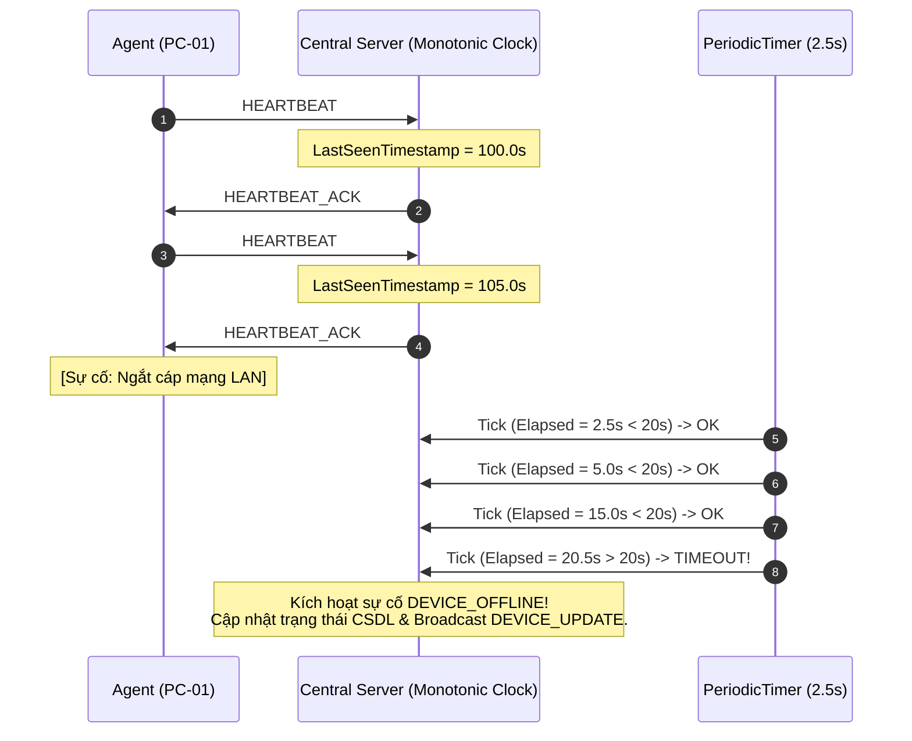
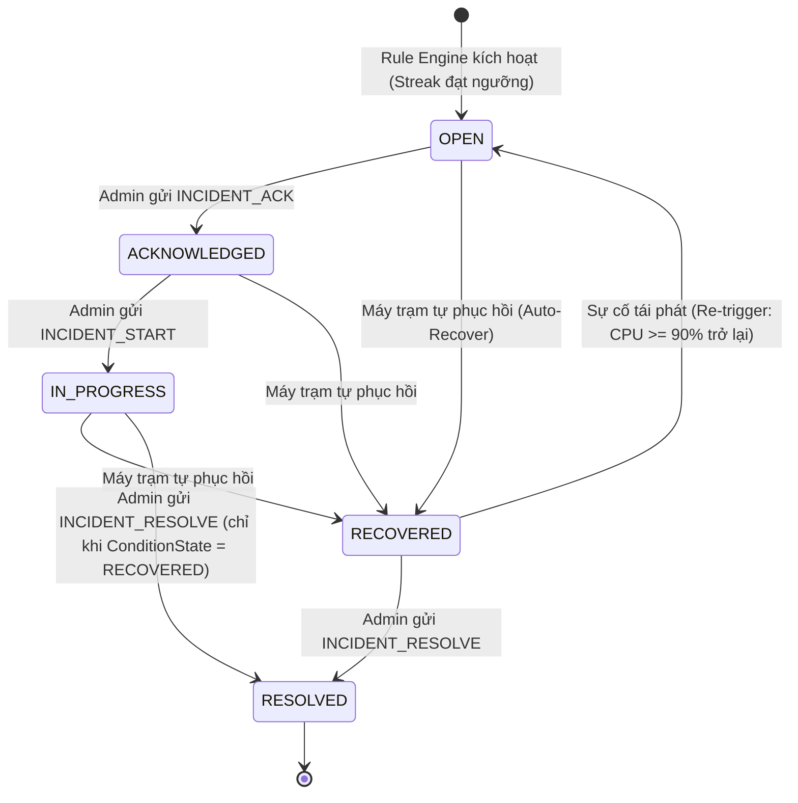

# LABGUARD — CHUYÊN ĐỀ GIÁM SÁT, PHÁT HIỆN SỰ CỐ & MÁY TRẠNG THÁI
**Mã tài liệu:** `research/04_MONITORING_DETECTION.md`  
**Chuyên đề:** Giám sát Sống/Chết (Heartbeat & Liveness), 4 Quy tắc Phát hiện Sự cố P0 (Streak & Hysteresis), Máy Trạng thái 2 Tầng (Dual-Layer State Machine) & Xử lý 5 Ca Biên (Edge Cases)  
**Môn học:** NT106 — Lập trình mạng căn bản (Khoa MMT&TT, UIT)  
**Trạng thái:** CHECKPOINT 2 REV2 — FREEZE CANDIDATE (READY FOR FINAL INDEPENDENT AUDIT)  
**Đối tượng thụ hưởng:** Thành viên B (Central Server / Rule Engine), Thành viên C (Admin Client UI), Thành viên A (Agent)  

---

## 1. TỔNG QUAN & MỤC TIÊU CHUYÊN ĐỀ

Một trong những bài toán cốt lõi của hệ thống giám sát mạng phân tán là **tính chính xác của dữ liệu** và **chống báo động giả (False Positives / Alarm Flapping)**:
- Nếu chỉ dựa vào một mẫu đo CPU tức thời vọt lên $92\%$ trong tích tắc do mở ứng dụng, hệ thống vội vã phát cảnh báo, người quản trị phòng máy sẽ nhanh chóng bị quá tải thông báo (Alert Fatigue).
- Nếu dùng đồng hồ hệ thống (`DateTime.UtcNow`) để kiểm tra xem máy trạm có hoạt động hay không, việc máy chủ tự động cập nhật giờ qua NTP hoặc người dùng chỉnh giờ máy tính có thể khiến toàn bộ 50 máy bị gắn nhãn nhầm là `OFFLINE` hoặc không bao giờ kích hoạt timeout.
- Nếu trạng thái sự cố chỉ có một cờ duy nhất `IsResolved = true/false`, hệ thống sẽ không thể biểu diễn được trường hợp: *"Máy trạm đã tự hạ tải an toàn, nhưng kỹ thuật viên phòng máy vẫn đang kiểm tra nguyên nhân"*.

Chuyên đề này chuẩn hóa các thông số kỹ thuật, công thức đo lường và logic chuyển trạng thái cho Checkpoint 2.

---

## 2. CƠ CHẾ GIÁM SÁT SỐNG/CHẾT (HEARTBEAT & LIVENESS SPECIFICATION)

### 2.1. Căn cứ Lựa chọn Đồng hồ Đơn điệu (Monotonic Clock)
1. **Clock Drift & Điều chỉnh Giờ:** Máy trạm sinh viên có thể bị lệch giờ vài phút hoặc bị chỉnh giờ về quá khứ. Nếu Server lấy timestamp do client gửi lên để tính khoảng cách thời gian, logic liveness sẽ bị sai lệch.
2. **NTP Step Adjustment:** Trên máy chủ Central Server, dịch vụ Windows Time (NTP) có thể điều chỉnh lùi giờ hệ thống để đồng bộ thời gian chuẩn. Một phép tính khoảng cách thời gian dựa trên `DateTime.UtcNow` có thể cho ra kết quả âm.
3. **Quyết định Kỹ thuật:** Central Server đánh giá liveness hoàn toàn dựa trên **Đồng hồ đơn điệu (Monotonic Clock)**:
   - Trong .NET: `Stopwatch.GetTimestamp()` hoặc `Environment.TickCount64`.
   - Đặc tính: Chỉ tăng tịnh tiến đều đặn theo chu kỳ xung nhịp phần cứng, không bị ảnh hưởng bởi múi giờ hay đồng bộ NTP.

### 2.2. Bộ thông số Liveness Chính thức

| Tham số | Giá trị chuẩn hóa | Định nghĩa kỹ thuật |
|:---|:---:|:---|
| `HeartbeatInterval` | **5.0 giây** | Chu kỳ Agent định kỳ tạo và gửi bản tin `HEARTBEAT` qua kết nối TCP. |
| `OfflineThreshold` | **20.0 giây** | **OfflineThreshold = 20.0s = 4 chu kỳ heartbeat.** Máy chủ đánh giá dựa trên thời gian đơn điệu trôi qua (`Stopwatch.GetTimestamp()`), không dùng bộ đếm số lần lỡ (not a missed-counter). |
| `LivenessCheckInterval` | **2.5 giây** | Chu kỳ đồng hồ hẹn giờ (`PeriodicTimer`) trên Central Server thức dậy quét toàn bộ bảng liveness trong bộ nhớ RAM. |



### 2.3. Nhận diện Phiên và Loại bỏ Gói tin từ Socket cũ
Khi máy trạm bị ngắt kết nối rồi kết nối lại nhanh, socket cũ trên server có thể vẫn còn mở trước khi bị phát hiện.
Để ngăn chặn các gói tin trễ từ socket cũ phá hoại trạng thái phiên mới, Central Server quản lý phiên bằng bộ nhận diện:
$$\text{LivenessKey} = (\text{DeviceId}, \text{SessionId}, \text{BootId}, \text{ConnectionGeneration})$$
- Mỗi khi một kết nối TCP mới từ cùng một `DeviceId` được thiết lập và xác thực qua `AUTH_AGENT`:
  1. `ConnectionGeneration` tăng thêm 1 đơn vị.
  2. Server đóng socket của thế hệ kết nối cũ hơn.
  3. Mọi gói tin đọc được từ socket có `ConnectionGeneration` nhỏ hơn thế hệ hiện hành bị hủy bỏ tại tầng Ingress Dispatcher.

### 2.4. Quy trình Phục hồi Sự cố DEVICE_OFFLINE Bắt buộc Xác thực
Một nguyên tắc bảo mật và toàn vẹn vận hành then chốt: **Bản tin `HELLO_AGENT` đơn lẻ tuyệt đối KHÔNG được phép phục hồi sự cố `DEVICE_OFFLINE` sang `ONLINE`**.
Sự cố `DEVICE_OFFLINE` chỉ được xem là phục hồi sau khi kết nối Agent mới hoàn tất tuần tự chuỗi bắt tay và xác thực thành công:
1. `HELLO_AGENT` $\rightarrow$ `HELLO_ACK`
2. `AUTH_AGENT` $\rightarrow$ `AUTH_RESULT(success == true)`
3. Sau khi xác thực thành công, bản tin `HEARTBEAT` hoặc bản tin nghiệp vụ hợp lệ đầu tiên từ phiên đã xác thực này được tiếp nhận sẽ cập nhật mốc `LastSeenTimestamp` trên Monotonic Clock, đóng sự cố `DEVICE_OFFLINE` và chuyển trạng thái thiết bị sang `ONLINE`.

---

## 3. BỘ 4 QUY TẮC PHÁT HIỆN SỰ CỐ P0 (P0 INCIDENT DETECTION RULES)

Để loại trừ các dao động tải nhất thời, toàn bộ các quy tắc giám sát hiệu năng của LabGuard áp dụng nguyên lý **Chuỗi mẫu liên tiếp (Streak)** kết hợp **Khoảng trễ (Hysteresis)**.

### 3.1. Bảng Đặc tả 4 Quy tắc Sự cố P0

| Mã Quy tắc (`RuleType`) | Mức độ (`Severity`) | Điều kiện Kích hoạt (`TRIGGER`) | Điều kiện Phục hồi (`RECOVERY`) | Cơ chế lọc |
|:---|:---:|:---|:---|:---|
| `DEVICE_OFFLINE` | **CRITICAL** | Server Monotonic Clock: $\text{ElapsedTime} > 20.0\text{ giây}$ không nhận được bất kỳ frame nào từ Agent. | Kết nối Agent mới hoàn tất bắt tay & xác thực thành công (`HELLO_AGENT` $\rightarrow$ `HELLO_ACK`, `AUTH_AGENT` $\rightarrow$ `AUTH_RESULT(success=true)`), sau đó nhận được frame/`HEARTBEAT` đã xác thực hợp lệ đầu tiên để cập nhật liveness. `HELLO_AGENT` đơn lẻ khi chưa xác thực tuyệt đối KHÔNG phục hồi `DEVICE_OFFLINE`. | **Kích hoạt tức thì** khi bộ quét phát hiện quá hạn 20.0s. |
| `HIGH_CPU` | **WARNING** | $\text{CPU} \ge 90\%$ trong **3 mẫu liên tiếp** (chu kỳ lấy mẫu 5s $\rightarrow$ trải qua cửa sổ quan sát 10 giây giữa mẫu 1 và mẫu 3). | $\text{CPU} \le 75\%$ trong **3 mẫu liên tiếp**. | Streak = 3 mẫu; Hysteresis delta = $15\%$. |
| `HIGH_MEMORY` | **WARNING** | $\text{RAM} \ge 85\%$ trong **3 mẫu liên tiếp** (cửa sổ quan sát 10 giây). | $\text{RAM} \le 70\%$ trong **3 mẫu liên tiếp**. | Streak = 3 mẫu; Hysteresis delta = $15\%$. |
| `SERVICE_DOWN` | **HIGH** | Local TCP Health Probe thất bại **2 lần liên tiếp** (chu kỳ probe 5s, timeout 2s). | Local TCP Health Probe thành công **2 lần liên tiếp**. | Streak = 2 lần probe. |

---

## 4. NGUYÊN LÝ HYSTERESIS & THỜI GIAN LÀM NGUỘI (COOLDOWN)

### 4.1. Hiện tượng Dao động Biên (Alarm Flapping)
Nếu hệ thống sử dụng một ngưỡng đơn duy nhất (ví dụ bật khi $\ge 80\%$, tắt khi $< 80\%$):
- Một máy trạm có mức tải dao động quanh $79.8\% \dots 80.2\%$ sẽ khiến hệ thống liên tục mở và đóng sự cố nhiều lần trong một khoảng thời gian ngắn, gây bão thông báo.

### 4.2. Khoảng trễ Hysteresis
LabGuard phân định độc lập **Ngưỡng Kích hoạt (Trigger Threshold)** và **Ngưỡng Phục hồi (Recovery Threshold)**:
- Đối với CPU: Kích hoạt khi $\ge 90\%$, nhưng chỉ phục hồi khi hạ xuống $\le 75\%$. Khoảng đệm an toàn $15\%$ giúp trạng thái duy trì ổn định.
- Đối với RAM: Kích hoạt khi $\ge 85\%$, nhưng chỉ phục hồi khi hạ xuống $\le 70\%$.

### 4.3. Thời gian Làm nguội (Cooldown Period)
- Giữa hai lần thay đổi trạng thái của cùng một sự cố trên cùng một thiết bị, hệ thống áp dụng một khoảng **Cooldown tối thiểu là 15 giây**.
- Ngăn ngừa việc trạng thái thay đổi quá nhanh làm gián đoạn việc theo dõi trên giao diện quản trị.

---

## 5. MÔ HÌNH MÁY TRẠNG THÁI 2 TẦNG (DUAL-LAYER INCIDENT STATE MACHINE)

### 5.1. Hai Tầng Trạng thái Độc lập
1. **Tầng 1 — Trạng thái Điều kiện Kỹ thuật (`ConditionState`):**
   - Được cập nhật tự động bởi Server Rule Engine dựa trên dữ liệu mạng.
   - Gồm 3 giá trị:
     - `ACTIVE`: Điều kiện sự cố đang diễn ra (ví dụ: CPU vẫn đang $> 90\%$).
     - `RECOVERED`: Máy trạm đã tự phục hồi về ngưỡng an toàn (ví dụ: CPU đã giảm về $\le 75\%$).
     - `UNKNOWN`: Mất kết nối mạng, không còn dữ liệu giám sát.
2. **Tầng 2 — Trạng thái Quy trình Vận hành (`WorkflowState`):**
   - Phản ánh tiến trình can thiệp của Quản trị viên trên giao diện WinForms.
   - Gồm 5 giá trị:
     - `OPEN`: Sự cố mới phát hiện, chưa có người tiếp nhận.
     - `ACKNOWLEDGED`: Quản trị viên đã gửi lệnh `INCIDENT_ACK` tiếp nhận.
     - `IN_PROGRESS`: Kỹ thuật viên bắt đầu xử lý (`INCIDENT_START`).
     - `RECOVERED`: Hệ thống ghi nhận máy đã phục hồi kỹ thuật nhưng chờ nghiệm thu đóng phiếu.
     - `RESOLVED`: Phiếu sự cố đã được đóng hoàn tất (`INCIDENT_RESOLVE`).

### 5.2. Sơ đồ Chuyển đổi Trạng thái



---

## 6. ĐẶC TẢ XỬ LÝ 5 CA BIÊN (EDGE CASES SPECIFICATION)

### Edge Case 1: Máy trạm tự phục hồi khi sự cố vẫn đang ở trạng thái `OPEN`
- **Tình huống:** Máy `PC-05` bị quá tải CPU ($95\%$), sự cố sinh ra với `WorkflowState = OPEN`, `ConditionState = ACTIVE`. Sau 2 phút, tác vụ kết thúc và CPU giảm xuống $40\%$ trong 3 mẫu liên tiếp trước khi Admin kịp can thiệp.
- **Xử lý của LabGuard:**
  - Rule Engine tự động cập nhật: `ConditionState = RECOVERED`, `WorkflowState = RECOVERED`.
  - Ghi nhận `IncidentHistory`: *"Hệ thống tự động chuyển sang RECOVERED do CPU giảm về mức an toàn (40.0%)"*.
  - Phát sóng `INCIDENT_UPDATE` tới các Admin Client. Trên giao diện WinForms, dòng sự cố đổi màu cảnh báo, Admin chỉ cần kiểm tra và gửi lệnh `INCIDENT_RESOLVE` để đóng phiếu.

### Edge Case 2: Sự cố tái phát trước khi Admin bấm đóng (`RESOLVED`)
- **Tình huống:** Sự cố đang ở trạng thái `ConditionState = RECOVERED`, `WorkflowState = RECOVERED`, nhưng người dùng máy trạm mở lại phần mềm nặng khiến CPU vọt lên $\ge 90\%$ liên tiếp 3 mẫu.
- **Xử lý của LabGuard:**
  - Không tạo thêm bản ghi IncidentId mới; tái kích hoạt sự cố hiện tại.
  - Cập nhật: `ConditionState = ACTIVE`, `WorkflowState = OPEN` (hoặc `IN_PROGRESS` nếu trước đó đã có người phân công), tăng `OccurrenceCount = OccurrenceCount + 1`.
  - Ghi log `IncidentHistory` và phát sóng `INCIDENT_UPDATE`.

### Edge Case 3: Admin gửi lệnh `INCIDENT_RESOLVE` khi máy trạm vẫn đang lỗi (`ConditionState = ACTIVE`)
- **Tình huống:** Máy trạm CPU vẫn đang ở mức $98\%$, Admin gửi lệnh `INCIDENT_RESOLVE` lên Central Server.
- **Xử lý của LabGuard:**
  - Server kiểm tra `ConditionState` hiện tại trong cơ sở dữ liệu.
  - Nhận thấy `ConditionState == ACTIVE`, Server từ chối thực thi và trả về bản tin `ERROR`:
    ```json
    {
      "version": 1,
      "messageType": "ERROR",
      "requestId": "550e8400-e29b-41d4-a716-446655440000",
      "deviceId": "SERVER",
      "sentAtUtc": "2026-09-14T08:00:00.0000000Z",
      "payload": {
        "errorCode": "ERR_CONDITION_STILL_ACTIVE",
        "message": "Không thể đóng sự cố khi tình trạng thực tế của thiết bị vẫn chưa an toàn (CPU hiện tại: 98.2% >= 75.0%)."
      }
    }
    ```

### Edge Case 4: Tranh chấp đồng thời khi 2 Admin cùng thao tác trên 1 sự cố (OCC Conflict)
- **Tình huống:** Admin A và Admin B cùng mở sự cố `INC-01` (phiên bản `RowVersion = 0x000000000001A2F4`). Admin A gửi `INCIDENT_ACK` thành công, làm phiên bản đổi thành `0x000000000001A2F5`. Ngay sau đó Admin B gửi `INCIDENT_RESOLVE` với phiên bản cũ.
- **Xử lý của LabGuard:**
  - Câu lệnh UPDATE kiểm tra `RowVersion = @ExpectedRowVersion` trả về `@@ROWCOUNT = 0`.
  - Server từ chối lệnh của Admin B và trả về bản tin `COMMAND_RESULT` (Status: 409 Conflict):
    ```json
    {
      "version": 1,
      "messageType": "COMMAND_RESULT",
      "requestId": "660e8400-e29b-41d4-a716-446655440001",
      "deviceId": "SERVER",
      "sentAtUtc": "2026-09-14T08:00:01.0000000Z",
      "payload": {
        "success": false,
        "errorCode": "ERR_CONCURRENCY_VIOLATION",
        "message": "Dữ liệu sự cố đã bị sửa đổi bởi phiên làm việc khác. Vui lòng làm mới danh sách."
      }
    }
    ```
  - Client của Admin B nhận lỗi này, hiển thị thông báo và tự động nạp lại dữ liệu mới nhất.

### Edge Case 5: Máy trạm mất kết nối (`DEVICE_OFFLINE`) khi đang có sự cố `HIGH_CPU`
- **Tình huống:** Máy `PC-09` đang có sự cố `HIGH_CPU` ở trạng thái `ACTIVE`. Đột nhiên máy bị tắt nguồn hoặc đứt cáp mạng.
- **Xử lý của LabGuard:**
  - Sau 20.0 giây không nhận được Heartbeat, Server mở sự cố mới với mã `RuleType = DEVICE_OFFLINE`, mức độ `CRITICAL`.
  - Đối với sự cố `HIGH_CPU` cũ: Do mất kết nối mạng, Server không thể đo đạc số liệu CPU mới $\rightarrow$ Chuyển `ConditionState = UNKNOWN`.
  - Bảng điều khiển Admin hiển thị rõ: Máy đã mất liên lạc, không gây hiểu lầm rằng CPU vẫn đang chạy ở mức $95\%$.
